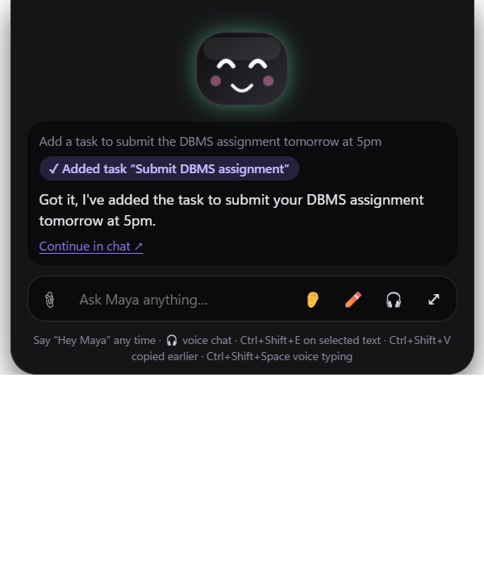

# Maya — a free, local-AI desktop assistant

Maya is a friendly assistant that lives at the top of your Windows screen. Move the mouse to the
very top edge (or press **Ctrl+Space**) and its face drops down. Type or talk to it, and it manages
your tasks, notes, reminders, habits, focus time and calendar, searches your files and the web,
reads and blurs pictures, draws new ones, and talks back. All AI runs **on your own computer**:
free, private, and it works with the Wi-Fi off.

College project (report name AETHER). Inspired by the feature lists of Hey Taby (heytaby.com) and Nixi
(heynixi.app); all code here is original. Called Ather until 1.6.1; renamed **Maya** in 1.6.3 (your data,
settings and downloaded models are kept: they stay in `%APPDATA%\Ather`).



## Features

| Feature | How to use it |
|---|---|
| Face at the top of the screen | Hover the top edge, or Ctrl+Space. Esc hides it. |
| Type it / Say it / It talks back | Type in the box, or press 🎤, speak, press again. Spoken questions get spoken answers. |
| Tasks, notes, reminders, habits, focus timer | “Add a task to submit DBMS Friday 5pm”, “remind me to drink water every day at 9pm”, “help me focus 25 minutes” |
| Undo | “undo that”, or the Undo button |
| Patterns | “How many tasks did I do today?”, “When am I most productive?” |
| Calendar | “Add a haircut Tuesday at 11”; Google/Outlook/Apple calendars via their private iCal link (Settings) |
| Inbox sorted | Connect Gmail/Outlook/Yahoo with an app password (Inbox); “anything important in my email?” |
| Smart search | Add folders in Smart search → Index; “find my beach photo”, “my resume” |
| Understand images | Attach or paste a picture and ask about it |
| Image editor | Image tools → Blur: hides faces, emails, phone numbers and names |
| Generate images | “Draw a cat on a desk”, or Image tools → Create |
| Type with your voice anywhere | Ctrl+Shift+Space in any app, speak, press again: the text is typed for you |
| Web search & reading pages | “Search the web for…”, “summarise this page: https://…”, “open YouTube” |
| Personalities | Normal, Brother, Anime Girl, Butler, Italian, Russian (Settings or “talk like a butler”) |
| Connect Claude / Codex / your own agent | Settings → Connect an AI agent (local MCP server, localhost only) |
| Hide the face | Settings → What the notch shows → Just the text box |
| Can my computer run it? | Setup screen and Settings |
| ChatGPT-style chat | Chat: separate conversations (auto-named, rename, delete), formatted answers with code, tables and maths, copy, regenerate, voice input |
| Several AI models | ✨ Auto picks per question: Fast (Qwen 3.5 4B) for actions, Smart (Qwen 3.5 9B) for explanations, Coder (Qwen 2.5 Coder 7B) for programming, Think harder (step-by-step reasoning) |
| Memory | Maya remembers lasting facts you mention (“my exam is on 14 December”); see and delete them in Settings |
| Chat with PDFs | Attach PDF, Word or text files in Chat (📄) and ask about them |
| Hands-free voice chat | 🎧 in the face window: just talk, it answers out loud; talk over it to interrupt; say “stop” to end |
| What's on my screen? | “What's on my screen?”, “explain this error on my screen” |
| Selected text actions | Select text in any app, press **Ctrl+Shift+E**: Explain, Summarise, Translate, Fix grammar, Reply |
| Study tools | Study: quizzes, flashcards and summaries from a topic, a note or a PDF, with scores |
| **1.2** Agent mode | Chat → model “Agent”: give a goal (“plan my exam week and add the tasks”); Maya writes a plan, works through it with a live checklist |
| **1.2** Code interpreter | “Plot y = x² with Python”, attach a CSV/Excel and ask for averages: Maya writes Python, **you click Run**, charts appear in the chat |
| **1.2** Makes files | “Make a 10-slide PPT on cloud computing”, “write my report as a Word document / PDF” → real .pptx/.docx/.pdf in Documents\Maya |
| **1.2** PC control & routines | “Open VS Code”, “volume 30”, “pause the music”, “brightness 60”, “lock my PC”, shutdown timers (asks first); routines like “study mode” run several actions |
| **1.2** Activity & focus blocking | Activity page: time per app/site, productive vs distracting; during focus sessions distracting apps get a nudge and are minimised |
| **1.2** Daily briefing | Morning briefing (weather, classes, tasks, emails) and 9 pm review, spoken; gentle nudges for overdue tasks and habits |
| **1.2** Lecture recorder | Study → Lectures: record the room or the computer's sound (online class); live transcript; notes, flashcards, quiz, “ask about it” |
| **1.2** Image extras | Remove backgrounds, upscale photos 2×; **Ctrl+Shift+S** snips part of the screen to ask about it |
| **1.2** “Hey Maya” | Optional wake word (Settings) starts a hands-free voice chat |
| **1.2** Dark theme | Settings → Appearance: the whole app, the face, the tray/taskbar icons and the Maya shortcuts turn black; face colours, eyes and accessories |
| **1.2** Own personalities | Settings: write how Maya talks and pick a voice |
| **1.2** PIN lock, backup, updates | PIN lock (on Windows lock / when away), backup and restore, weekly auto-backup, update check |
| **1.3** Live face | The face blinks, glances around, breathes; shows feelings from what you say (worried when you ask many things at once, happy, sad, excited), a gear while a tool runs, a waveform while listening or speaking. Settings → Appearance: glow, motion (full / subtle / off) |
| **1.3** More pictures | “Draw 4 pictures of a red car”, portrait/landscape; SDXL-Turbo (optional download) for much better images, SD-Turbo otherwise |
| **1.3** Any AI model | AI models page: Ollama, LM Studio, OpenAI, Groq, OpenRouter, Gemini, Anthropic or any OpenAI-compatible server; test button, API keys kept encrypted, usage table. Cloud models never get your screen or files unless you allow it |
| **1.3** Connected tools (MCP) | Filesystem, GitHub, Playwright browser, Context7 docs, Sequential thinking, plus any server you add. Each shows “Connected” only after a real call; permission per server (ask / auto for reading / off), logs, “try a tool” |
| **1.3** File manager, Git, databases, time | “Organise my Downloads”, “what changed in my project?”, “show the tables in this .db” (read-only), “what time is it in New York?” — only inside approved folders; deleting goes to the Recycle Bin and asks first |
| **1.3** Coding engineer | “Fix the failing test in my project”: reads files, runs the tests, edits, runs again (inside approved folders, commands ask first) |
| **1.3** Computer control | “Type hello in Notepad”, “click Save”: Maya asks once per task, a banner shows while it works, **Esc** stops it at once; every action is in Activity → Maya's actions |
| **1.3** Memory brain | Preferences, projects and facts; duplicates merged, newer facts replace older ones, passwords/keys never saved; edit, forget and export in Settings |
| **1.3** Workflows | Workflows page: describe it in words → editable steps → save; watch each step live (waiting, running, awaiting approval, done, failed, cancelled); pause, resume, cancel, retry; run history; daily schedule |
| **1.3** Timetable & exams | Study → Timetable & exams: import from a photo or PDF, classes on Home and in the briefing, a reminder 10 minutes before each class, exam countdown |
| **1.3** Clipboard history | **Ctrl+Shift+V**: paste something you copied earlier (memory only, passwords skipped) |
| **1.3** Live captions | **Ctrl+Alt+C**: captions for any sound on the computer (videos, online classes, calls), optionally translated to English |
| **1.3** Health breaks | Water, 20-20-20 eye breaks and stretching, counted only while you use the PC, quiet during focus |
| **1.3** Open any app by voice or text | “Open WhatsApp”: Start menu, then Store apps; if it is not installed Maya opens Chrome, searches for it and tells you |
| **1.3** Builder (Supervisor → Engineer → QA → DevOps) | Chat → model “Builder”: “build a portfolio website for…”. The Supervisor plans, the Engineer writes the files in Documents\Maya Projects, QA opens the site and checks for errors (fixing them), DevOps commits with Git and, only if you ask, publishes to GitHub Pages (asks first) |
| **1.3** Head mouse (hands-free) | **Ctrl+Alt+H** or “turn on head mouse”: the webcam follows your head to move the cursor; open your mouth to click, smile to right-click (MediaPipe, runs on this PC) |
| **1.3** This PC | Activity page: live CPU, RAM, GPU, disk, battery and the busiest apps; “why is my laptop slow?” |
| **1.3** Start with Windows, one-click setup | Settings; `start.bat` runs from source, `install.bat` installs on another PC |
| **1.3.1** Full PC control | “Search for Chennai weather in Chrome”, “message Rahul on WhatsApp…”: Maya sees inside browsers and apps, gets a screenshot with numbered controls and a grid, types like a person (Tamil too), looks again after every step and tries another way if something did not work. It works only in the app it opened, never deletes your text, and Esc stops it |
| **1.3.1** Voice-only control (for people who can only speak) | In hands-free voice mode: “show numbers” → “click 12”, “show grid” → “click D7”, “scroll down”, “press enter”, “type …”, “go back”, Tamil “கீழே போ”. Permission cards are answered by voice: “yes / no / சரி / வேண்டாம்”. The face tilts and shows “?” while it waits, and nods when done |
| **1.3.1** Tamil voice and listening | Maya speaks Tamil with Meta's MMS voice and understands Tamil with a Tamil-trained Whisper (about 2% wrong characters instead of 15%), both offline. Set Settings → “Language you speak to Maya” → Tamil; the models download once |
| **1.4** Accessibility page | One place for everything below, plus a **Large and high-contrast** mode (bigger text and buttons, strong focus outlines) |
| **1.4** Dwell click | Head mouse: hold the pointer still to click — no mouth movement needed; a yellow ring fills at the cursor |
| **1.4** On-screen keyboard | Big English and Tamil keys for head mouse / dwell / switch users, word suggestions that learn your words (never passwords), Ctrl+C/V/Z and an SOS key. “Open keyboard” |
| **1.4** Switch scanning | For people who can press only one button or say one word: controls light up group by group, then one by one; the switch key (F9), “select”, or a mouth-open picks |
| **1.4** Read aloud + voice editing | “Read the screen” / “திரையை படி” reads the window aloud (English or Tamil); “delete last word”, “new line”, “select all”… |
| **1.4** Emergency SOS | “Help” / “உதவி” / SOS key / button → 10 s to cancel by voice → loud alarm, full-screen “I need help” sign and an email to caregivers; works even when Maya is PIN-locked; optional “Are you okay?” check-in after long silence |
| **1.4** Face designs and a livelier face | Shapes (classic, round, robot, cat, blob), liveliness (calm / normal / lively), eyes that follow the mouse, voice ripples, SOS / sleep / wake / confetti moods |
| **1.5** Email: read, search, summarise | “Any emails from Rahul?”, “read the latest one”, “summarise my unread mail” — by voice or text |
| **1.5** Email: reply and send | Maya writes the reply; it is sent only after you allow it (card or “yes” by voice). Replies stay in the same thread |
| **1.5** Email → tasks and calendar | Deadlines and meetings found in an email are added to tasks / reminders / calendar after you allow it |
| **1.5** Tidy the inbox | Mark read; find newsletters and ads and move them to the archive (never deleted) after you allow it |
| **1.5** Follow-ups | “Remind me if Rahul doesn’t reply by Friday” — Maya tells you when he replies, or adds a follow-up task on Friday |
| **1.5** Work dashboard + weekly report | Home shows emails waiting on you and follow-ups; every Friday at 5 pm a Word report of your week (done, open, coming up, focus time) |
| **1.6** Work timer + goodbye shutdown | “I’ll work for 2 hours, then shut down”: at the end Maya sums up your day, says “Bye sir, have a great day”, and shuts down after one minute — say “wait” for 15 more minutes. Apps with unsaved work still ask to save |
| **1.6** Ask ChatGPT / Claude | “Ask ChatGPT …” / “ask Claude …” types the question in your own browser (your account), waits for the answer and reads it aloud; “both” compares them. It never answers a human check for you |
| **1.6** Emergency phone call | “Help” now also calls your emergency number through Windows Phone Link (your paired phone), at the same time as the caregiver email |
| **1.6** Blink to click | For people who can hardly move their head: close both eyes for half a second to click, 1.5 s to right-click; normal blinks are ignored |
| **1.6** Medicine and care reminders | Maya asks you to say “done”; if nobody confirms within 15 minutes, your caregivers get an email |
| **1.6** Read documents by voice | “Read my document DBMS notes”, then “next page”, “repeat”, “page 5” (also அடுத்த பக்கம், மீண்டும்) |
| **1.6** Voice magnifier | “Magnify”, “magnify less”, “stop magnifier” (பெரிதாக்கு) drive the Windows Magnifier |
| **1.7** Skills Maya can learn | 13 built-in skills (research report, study notes + quiz, job application, budget, trip plan, meeting notes, slides, plan my day, inbox clean-up, my morning, care day, explain my screen, build me an app) used by themselves when they fit; teach your own by voice: “teach yourself: when I say goodnight, …” (Skills page) |
| **1.7** Learns from you | Your corrections (“no, always…”) and 👍/👎 notes become preferences it follows; words it mishears are learned when you fix them; “good answer” / “bad answer” by voice; My Maya → What Maya learned (edit, forget) |
| **1.7** Work monitor + lively face | Every action in plain words, live (Work monitor page); “what are you doing?” / “what did you do today?”; while working the face types, builds (hard hat), searches (lens) or checks (tick) |
| **1.8** “Hey Maya”, no button | The wake word is on from the start: say “Hey Maya” and Maya answers “Good morning, boss! What’s the work today?” (afternoon / evening / late night), then listens; nobody has to click the mic |
| **1.8** Talks while thinking | Like NVIDIA PersonaPlex, within a 6 GB laptop: in voice mode Maya speaks each sentence as soon as it is written, and stops the moment you talk over her |
| **1.8** Jarvis jobs | Say a job of several steps (“open my WhatsApp chat and download the video to the desktop”): Maya plans it and does each step on screen, asking before anything risky; a glowing Jarvis orb face (Appearance) |
| **1.8** WhatsApp chat + downloads | “Open my WhatsApp chat 98400 12345”, “save the video from my WhatsApp to the desktop”: opens the chat in your signed-in Chrome, downloads the video and moves it to your real Desktop (also when it is in OneDrive) |
| **1.8** No mic button needed | With “Hey Maya” on (the default), the mic button becomes an always-listening sign; anyone can start by voice alone |
| **1.8** Never forgets | After each conversation Maya thinks back and saves lasting facts you mentioned (people, plans, dates, needs), never passwords or repeats |
| **1.8** Talks like a person | Warm, short, natural replies that say what it is doing (“Okay, opening YouTube…”) |
| **1.8** YouTube by voice | “Open YouTube, scroll down and play the first video”, “pause”, “full screen”, “next video” |
| **1.8** Connections page | Email, Google / Outlook / Apple Calendar, WhatsApp, phone, Chrome accounts, cloud AI and tools, each with its status and one big button |
| **1.8** More faces | Jarvis orb, Bear, Alien and Ghost (Appearance) |
| **1.8** A smarter brain | Hard questions (solve, prove, puzzles, “step by step”) go to the 9B model with deep thinking; everyday ones stay fast |
| **1.8** Second brain you can see | Brain page: a mind map of everything Maya knows about you (people, facts, likes, goals, plans, notes, skills), searchable, “ask your brain”, glowing live while Maya works |
| **1.8** Routines, WhatsApp and phone by voice | “Every morning at 8, read my emails and today’s tasks”; “read my new WhatsApp messages”, “reply to Amma that I’m coming” (sent only after you say yes); phone notifications, texts and calls through Phone Link |
| **1.8** Inactivity alert | Optional: during the hours you choose, the webcam (one look every 10 minutes, never saved) also counts as “you are there”; no one, no typing and no voice for hours → “Are you okay?”, then your caregiver |
| **1.8** Nod = yes, shake = no | With the head mouse on, nod to allow an approval card and shake your head to cancel it: no voice or click needed |
| **1.8** Snippets | “Save my address as …”, then “type my address” in any app (also email, phone, IFSC…); never passwords |
| **1.8** Quick actions | Big one-press buttons on Home (“What is on today?”, “Read my new emails”, “Call Amma”, 🆘 Help), editable; Maya does it and says the answer |
| **1.8.2** AI works on every laptop | When only the small 2B brain is installed, Maya switches to Lite by itself (before: "model 'ather-brain' not found" on friends' laptops); a missing brain gives a clear "not downloaded yet" message |
| **1.8.2** One-file start.bat | Works even from inside the zip; installs Ollama + the brain that fits, Python 3 (numpy, pandas, matplotlib, openpyxl), Node.js, Git and Maya; asks the AI a test question; writes **MEMORY.md** (laptop, everything installed, what worked) |
| **1.8.2** New Home | A listening hero (Maya's face in a halo that breathes while it listens for its name, greeting, brain and privacy chips) and quick-action tiles with icons |
| **1.8.1** "Hey Maya" fixed | It works after any wait (the quiet before the words was making the clip too long) and when Whisper mishears "Hey" ("Tae Maya"); checked live with `scripts/wake-e2e.mjs` |
| **1.8.1** Setup fits the laptop | The first screen downloads only the models this laptop can run, by itself (no click) |
| **1.8** Share with a friend | `Maya-1.8.0-share.zip` on the release page: unzip, double-click `start.bat`; it checks the laptop and downloads the models that fit (Lite 2B / Standard 4B / Full 4B + 9B + Coder) |
| **1.7.1** Coding agent | Coding goals in Agent mode use the 9B model; a precise “replace this text” edit tool (fs_edit) that also handles a whole corrected file; never edits files with shell commands; checked on JavaScript and Python bug fixes without touching the tests |
| **1.7** Coder and Builder | Qwen 2.5 Coder 7B answers coding questions; “build me a … website/app” by voice goes to the Builder, which writes, checks and opens the result; tool calls a model writes as text still run |
| **1.7** My Maya | Its name (wake word follows: “Hey Priya”), what it calls you, your rules and goals, voice and speed, look presets, accent colour, text size, spacing, hide pages; all by voice too (“make the text bigger”, “talk slower”) |
| **1.7** Drag by voice, “again” | “Drag 3 to 7” / “drag D4 to F6” drags and drops without a mouse; “again” repeats the last action (scroll, click, drag, page) |
| **1.7** “What is this?” | Point with the mouse or head mouse and ask: Maya says what is under the pointer (“Button: Send”, “Text box: Search, it contains …”); also “இது என்ன” |
| **1.7** Daily “I’m okay” email and SOS location | Optional evening email to caregivers (medicines taken / missed, how the day went); optional approximate location in the SOS email (Accessibility page) |
| **1.7** Open your accounts | “Open Gmail / ChatGPT / Claude / Gemini / WhatsApp / YouTube / Drive” goes straight to the site in your own Chrome profile, where you are signed in (no Google search); “ask ChatGPT …” uses it too |
| **1.7** Voices | Free offline English (7 voices) and Tamil, or OpenAI’s voices (the ones ChatGPT uses: Nova, Shimmer…) with your own OpenAI key |
| **1.6.1** Fixes | “Turn off the PC” and other words Maya did not recognise no longer get “I can’t”: it uses its tools; emails are sent in your own words and read out before you say yes; AI models “Test connection” works; magnifier gives focus back to your app |
| **1.6.6** Contacts, calls and WhatsApp by voice | “Save Amma’s number 98400 12345”, “call my doctor” (through your paired phone, asks first), “WhatsApp Rahul that I’ll be late” (opens the chat with your message ready; you press Send or say “press enter”) |
| **1.6.6** Voice diary | “Dear diary, physio went well today”: saved with its mood; “how was my week?” gives a gentle summary. Never sent to cloud models |
| **1.6.6** Lite brain | Qwen 3.5 2B for PCs without a graphics card or with 8 GB memory: switched on by itself on slower PCs (Settings → Helpers → Speed) |
| **1.6.5** Camera eyes | “What’s in front of me?”, “what am I holding?”, “what colour is this?”: Maya looks through the webcam and describes it. “Read this paper / label / bill”: hold it up and Maya reads the printed text aloud (medicine labels: name, dose and warnings first). A photo is taken only when you ask, and never saved |
| **1.6.5** Interpreter | “Be my interpreter in Tamil”: you and another person just talk; Maya says each sentence in the other language (English ↔ Tamil, Hindi, Telugu, Bengali, Arabic, Russian, Japanese, Korean, Chinese). Say “stop” or “நிறுத்து” to end |
| **1.6.3** Hold to talk | Hold **Right Ctrl** and talk to give Maya a command; hold **Right Alt** and talk to type into any app; let go to finish. A quick tap or Right Ctrl+C still works normally (Settings → Helpers) |
| **1.6.3** Clean dictation | Removes “um / uh”, follows “ten, actually fifteen”, turns “comma”, “new line”, “bullet point” into text; *Polished* also lets the local AI fix small slips |
| **1.6.3** Write here | ✏️ on the pill, or “write a reply thanking Sam for dinner”: Maya writes a first draft in your own style and types it where your cursor is |
| **1.6.3** Teleprompter that listens | Copy your script, say “start teleprompter” (or tray menu): it scrolls as you read aloud and waits when you pause; Esc closes |
| **1.6.3** Where is it? | “Where’s the Save button?”: an arrow points at it on screen |
| **1.6.3** Timers, lists, dark mode, music | “Set a timer for 10 minutes” (shown on the pill), “add milk to my shopping list”, “turn on dark mode”, “play Billie Jean” (starts playing on YouTube) / “… on Spotify” |
| **1.6.3** Any pill, any eyes | Appearance → Custom colour: Pill, Shade and Eyes sliders; text and eyes switch light/dark by themselves; Shades look; “Thank Maya” hearts; new wink, meh and groove (while music plays) moods |
| **1.6.3** Maya | New name and wake word “Hey Maya” (Whisper hears it far better than “Ather”); “Hey Ather” still works |
| **1.6** Daily work monitor | Home shows today’s working vs distracted time; the weekly report adds time per app; the shutdown goodbye tells you how the day went |

## Programming languages

| Language | Used for |
|---|---|
| JavaScript (Node.js 24, ES modules) | Everything in the main process: AI brain, tools, database, speech, search, mail, calendar, MCP server |
| JSX (React 19) | All screens: the face window and the main app |
| HTML + CSS | Page structure and styling |
| SQL | The local SQLite database |
| PowerShell (small snippets) | Windows voices, simulated Ctrl+C / Ctrl+V, the computer check |
| JSON | Settings, tool definitions, model lists |

Third-party engines underneath (not written for this project): Electron/Chromium (C++), Ollama + llama.cpp (Go/C++),
ONNX Runtime (C++), stable-diffusion.cpp (C++).

## How it works

```
Electron main process (Node 24)
├── brain.js        Ollama (OpenAI-style API) + tool-calling loop, streaming
├── tools/          35 tools the AI can call (tasks_create, notes_query, images_generate, …)
├── store.js        SQLite (node:sqlite) with undo log
├── services/       web search, smart search, imaging, mail (IMAP), calendar feeds,
│                   scheduler (reminders/focus), MCP server, Windows voices, system check
├── ml/             utility process: Whisper, Kokoro, CLIP, Tesseract OCR, UltraFace
└── windows.js      notch window (hover detection), main window, tray, shortcuts
Renderer (React + Vite)
├── notch.jsx       the face, answer bubble, mic, attachments
└── app/            Home, Chat, Tasks, Notes, Habits, Focus, Calendar, Inbox, Search, Image tools, Settings
```

The same tool registry is used by the chat, by the app screens, and by the MCP server, so every
action behaves the same whichever way it is triggered.

### AI models (all free, downloaded once, ~6.5 GB)

| Job | Model |
|---|---|
| Brain + vision + tool calling | Qwen 3.5 4B via Ollama (as `ather-brain`, 12K context) |
| Smart answers | Qwen 3.5 9B via Ollama (as `ather-smart`, 12K context) |
| Code answers | Qwen 2.5 Coder 7B via Ollama (optional, used when installed) |
| Documents and memory search | nomic-embed-text via Ollama |
| Listening | Whisper small (ONNX, transformers.js), ~99 languages; Tamil: Whisper Tamil small (vasista22, Apache-2.0), converted to ONNX for Maya |
| Voice | Kokoro-82M (English voices); Tamil: Meta MMS-TTS Tamil (CC-BY-NC 4.0), converted to ONNX; Windows voices for other alphabets (if installed) |
| Text search | nomic-embed-text via Ollama |
| Photo search | CLIP ViT-B/32 |
| Reading text in images | Tesseract (English) |
| Finding faces | UltraFace RFB-320 |
| Drawing pictures | SD-Turbo, or SDXL-Turbo when downloaded, via stable-diffusion.cpp (Vulkan, runs on the GPU) |

### How we learned how Taby works

We reverse engineered the free Taby 1.0.13 Windows installer with
[REA](https://github.com/morluto/rea) (static analysis only, nothing executed): it is an
Electron + React app that runs llama.cpp's `llama-server` with Qwen 3.5 4B, about 60 named AI tools,
SQLite storage, Parakeet speech-to-text, Kokoro/Supertonic voices, EmbeddingGemma search and a
local MCP server. Maya follows the same overall design with original code and its own choices
(Ollama instead of a bundled llama.cpp, Whisper instead of Parakeet for Indian languages).

## Source code in order

`node scripts/pack-source.mjs` writes [docs/CODE_GUIDE.md](docs/CODE_GUIDE.md) (every file with what it does,
grouped by the project report's modules), [docs/SOURCE-LISTING.md](docs/SOURCE-LISTING.md) (all the code in that
order, for printing) and `release/Maya-<version>-source.zip`.

## Run it

**Share with a friend:** send `release/Maya-<version>-share.zip` (also on the GitHub release; build it with
`node scripts/make-share.mjs` after `npm run dist`). Your friend unzips it and double-clicks **`start.bat`**: it checks
the laptop and picks the models that fit, then installs Ollama and Maya:

| Laptop | Models | Download |
|---|---|---|
| No 4 GB graphics card, or under 10 GB RAM | Lite: Qwen 3.5 2B | ~3 GB |
| 4–5 GB graphics card | Standard: Qwen 3.5 4B | ~4 GB |
| 6 GB+ graphics card and 14 GB+ RAM | Full: Qwen 3.5 4B + 9B + Qwen 2.5 Coder 7B | ~15 GB |

Big models are dropped first when the disk is short. It also installs Python 3 (numpy, pandas, matplotlib, openpyxl), Node.js
and Git, tests the AI, and writes `MEMORY.md` with what it found and did. `start.bat dry` shows the plan without installing;
`powershell -File scripts/test-share-plan.ps1` checks the plan for six kinds of laptop.

On any Windows PC: double-click **`install.bat`** (installs Ollama and the latest Maya release, then the
models), or **`start.bat`** to run from this source folder (installs Node.js and Ollama if missing).

Requirements: Windows 10/11, 8 GB RAM (16 GB better), a GPU with 4 GB+ (RTX 4050 tested),
[Ollama](https://ollama.com/download) installed.

```bash
npm install
node scripts/fetch-models.js
npm run dev
```

The installed app downloads the models itself from its setup screen.

## Build the installer

```bash
npm run dist
```

Output: `release/Maya-Setup-<version>.exe` (~210 MB; models are downloaded on first run, not bundled).

## Publish an update

Installed copies check https://github.com/Achu226/ather/releases every 6 hours (and from Settings →
Check for updates), download new versions in the background and install them on restart.

1. Change `"version"` in `package.json` (e.g. `1.3.1`).
2. `npm run dist`
3. `npm run release -- "What changed in this version"` (uses the GitHub CLI, signed in as Achu226)

## Tests

```bash
npm test
node scripts/e2e.mjs
node scripts/e2e.mjs "release/win-unpacked/Maya.exe"
node scripts/voice-e2e.mjs
node scripts/a11y-e2e.mjs
```

- `npm test`: 22 tests. Unit tests for tools, undo, scheduler and audio decoding, plus real-model
  checks: the brain creating a task, Kokoro → Whisper round trip, CLIP, image generation, face
  detection, OCR blur, smart search, the MCP server, a public Google calendar feed, web search.
  Model tests skip themselves when the models are not downloaded.
- `scripts/e2e.mjs`: drives the real app with Playwright and saves screenshots to `docs/screenshots`.

## Conversation quality

`node scripts/nlp-eval.mjs <label>` runs 27 scripted conversations (follow-ups, Hinglish/Tanglish,
emotional support, trick questions, actions) and has Qwen 3.5 9B grade each answer from 1 to 5. Reports
are in `docs/nlp-eval-*.md` (baseline vs. final).

Two design choices came out of it: each request only sees the tools it can need (tools/select.js), and
only real coding requests go to the coder model.

## Not included (and why)

- Physical desk robot: needs the hardware.
- Phone/web app and paid plans: everything here is already free and local.
- Video generation: not offered by Taby either (“coming soon”).
- Adding events *into* Google/Outlook: needs an OAuth app registered with Google/Microsoft;
  Maya reads those calendars and keeps new events in its own calendar.
- Filling in website forms for you: Maya opens and reads pages instead.
- App screens in 14 languages: the screens are English; the AI answers in your language.
- The installer is not code-signed, so Windows SmartScreen will warn on first install
  (More info → Run anyway).
